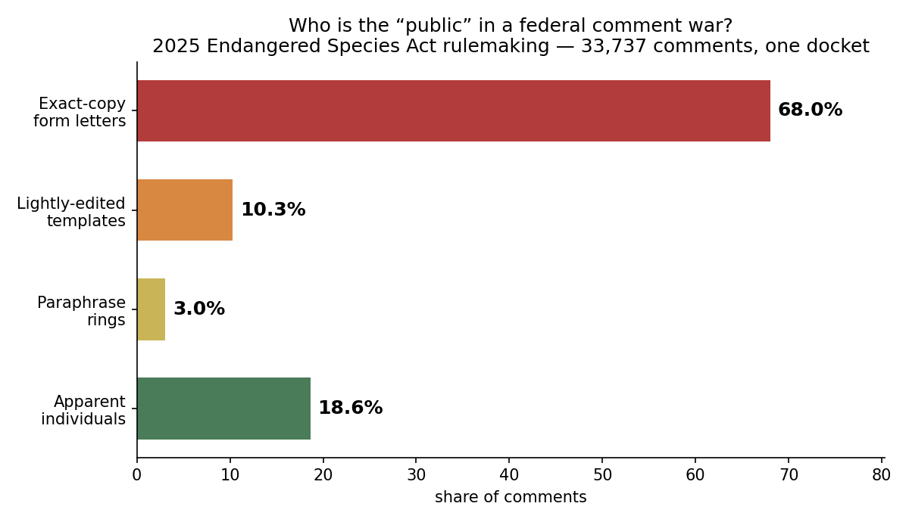

# Who Is Actually Talking When America Comments on Its Laws?

*A forensic dissection of 35,000 public comments on one of 2025's biggest
environmental fights — and a search for the AI flood everyone expects.*

---

## The question

When a U.S. federal agency proposes a rule — on endangered species, drug
scheduling, workplace safety — it is required by law to ask the public for
comments, and to read and consider them. This is one of the few direct lines
between ordinary people and the regulatory state.

Two things made us want to X-ray that channel in 2026:

1. **Science got flooded.** Multiple studies have documented a measurable surge
   of AI-generated text in research papers after ChatGPT (late 2022).
2. **The comment system has been gamed before.** The 2017 net-neutrality
   proceeding famously drowned in millions of fake comments — *before*
   generative AI existed.

So: **is AI now writing America's public comments?** Nobody had measured it.
We did — first broadly, then with a scalpel.

## How we measured (and how we kept ourselves honest)

We used the same family of methods that exposed AI text in scientific papers:
a lexicon of words and constructions that spiked in human writing only after
ChatGPT ("delve," "underscore," "it is important to note…"), scored as a rate
per 1,000 words. No single word proves anything — the signal is a *rate* and
its *change over time*.

Two design choices did the heavy lifting:

- **A built-in answer key.** Comments posted before November 2022 *cannot* be
  AI-generated. They are a guaranteed-human baseline. We set our "suspect"
  threshold so exactly ~10% of guaranteed-human comments trip it — then any
  excess above 10% in later comments is signal, not noise.
- **Plant-and-recover validation.** Before trusting any instrument on real
  data, we planted known AI text (and, later, synthetic paraphrase rings) in
  clean corpora and required the instrument to find them — and to find
  *nothing* in pure-human controls. Two early "exciting findings" died in
  these checks (a statistics bug, then a small-sample mirage). They never
  reached this page; that is the point of the method.

Data came from the public [Mirrulations](https://registry.opendata.aws/mirrulations/)
mirror of regulations.gov — no special access, fully reproducible.

## Finding 1: the AI flood has not arrived

Across 1,306 deduplicated comments spanning six agencies (EPA, FDA, CMS, DEA,
OSHA, FWS), matched within-agency before vs. after ChatGPT:

> **Suspect rate 10.1% before vs 11.8% after — statistically
> indistinguishable** (docket-level permutation p = 0.33).

Unlike scientific publishing, federal public comments show **no detectable
surge of heavy AI-register text**. A small pilot sample had hinted at a
doubling; the 10×-larger powered run erased it. (Subtle AI assistance that
doesn't produce the florid register is not excluded — our detector is
calibrated for the style that flooded the journals.)

## Finding 2: what the "public" actually is — an autopsy

Averages hide structure, so we dissected a single battlefield end-to-end:
docket **FWS-HQ-ES-2025-0039**, the fiercely contested proposal to rewrite the
Endangered Species Act's definition of "harm." We pulled every comment —
35,714 — and clustered the 33,737 with usable text into families: exact
duplicates, lightly-edited templates, and *paraphrase rings* (same skeleton,
reworded — the signature LLM-era astroturf would leave).

The anatomy of the "public voice" on this rule:

| who | share |
|---|---|
| **Exact-copy form letters** | **68.0%** |
| Lightly-edited templates | 10.3% |
| Paraphrase rings | 3.0% |
| Apparently individual comments | **18.6%** |

Concretely:

- **One single form letter appears 14,336 times — 42% of the entire docket.**
  One piece of text outweighs every individually-written comment combined.
- A 551-copy religious-themed letter arrived **100% on one day** — a
  coordinated batch dump, not a congregation moved to write.
- The largest paraphrase ring has 540 members spanning 20 days.

**And the machinery is human.** The docket-wide AI-register rate is 7.6% —
*below* the human baseline. Even the paraphrase rings score in the human
range; they look like advocacy-platform "personalize your message" tools, not
language models.

## What this means

1. **Four out of five "public voices" on a major federal rule are
   mass-produced campaign mail.** When an agency says it received 35,000
   comments, the number of distinct human arguments may be two orders of
   magnitude smaller.
2. **The astroturf machine predates AI and hasn't needed it (yet).** The
   tooling that matters today is the email-this-form advocacy platform, not
   ChatGPT.
3. **When the AI wave does arrive, it will be visible.** This project leaves
   behind a validated, open-source instrument and a clean 2019–2025 baseline.
   The paraphrase-ring share (3%) and AI-register rate (7.6%) of this docket
   are now on the record; movement in those numbers is detectable the week it
   happens.

## Caveats, stated plainly

- A flagged comment is **not** an accusation against any individual — humans
  legitimately use every word in our lexicon. Only rates and trends carry
  meaning, which is why we report nothing about any named commenter.
- ~2,000 attachment-only comments (PDFs) were not analyzed.
- Our detector catches the heavy "ChatGPT register." Lightly-AI-assisted text
  that reads naturally is beyond its floor — documented, not hidden.
- Paraphrase rings indicate coordination, not necessarily any specific tool.

## Reproduce it

Everything — detector, clusterer, fetchers, validation suites, and the full
analysis — is in this repository. The data source is public. Start with
`README.md`; every claim above re-derives from committed code.

*Independent research, November 2026.*
